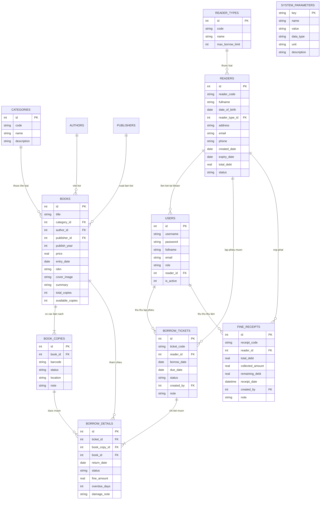

# THIẾT KẾ CƠ SỞ DỮ LIỆU & SƠ ĐỒ THỰC THỂ QUAN HỆ (ERD)
## MÔN THIẾT KẾ PHẦN MỀM (TKPM)

---

### 1. SƠ ĐỒ THỰC THỂ QUAN HỆ (ENTITY RELATIONSHIP DIAGRAM - ERD)

---

### 2. CHI TIẾT CẤU TRÚC CÁC BẢNG (DATA DICTIONARY)

#### 2.1 Bảng `system_parameters` (Cấu hình quy định QĐ1 - QĐ6)
| Tên cột | Kiểu dữ liệu | Ràng buộc | Mô tả |
|---|---|---|---|
| `key` | TEXT | PRIMARY KEY | Khóa định danh tham số (VD: min_reader_age) |
| `name` | TEXT | NOT NULL | Tên hiển thị của quy định |
| `value` | TEXT | NOT NULL | Giá trị của quy định |
| `data_type` | TEXT | NOT NULL | number / boolean / string |
| `unit` | TEXT | NULL | Đơn vị tính (tuổi, ngày, tháng, VNĐ...) |
| `description` | TEXT | NULL | Giải thích quy định |

#### 2.2 Bảng `categories` (Thể loại sách - QĐ1)
| Tên cột | Kiểu dữ liệu | Ràng buộc | Mô tả |
|---|---|---|---|
| `id` | INTEGER | PRIMARY KEY AUTOINCREMENT | Mã định danh thể loại |
| `code` | TEXT | UNIQUE, NOT NULL | Ký hiệu mã thể loại (A, B, C...) |
| `name` | TEXT | NOT NULL | Tên thể loại (CNTT, Kỹ thuật...) |
| `description` | TEXT | NULL | Mô tả chi tiết |

#### 2.3 Bảng `books` (Đầu sách / Tựa sách)
| Tên cột | Kiểu dữ liệu | Ràng buộc | Mô tả |
|---|---|---|---|
| `id` | INTEGER | PRIMARY KEY AUTOINCREMENT | Mã sách |
| `title` | TEXT | NOT NULL | Tên đầu sách |
| `category_id` | INTEGER | FK -> categories(id) | Mã thể loại sách (QĐ1) |
| `author_id` | INTEGER | FK -> authors(id) | Tác giả |
| `publisher_id` | INTEGER | FK -> publishers(id) | Nhà xuất bản |
| `publish_year` | INTEGER | NOT NULL | Năm xuất bản (QĐ1 kiểm tra $\le 8$ năm) |
| `price` | REAL | NOT NULL | Trị giá của cuốn sách (VNĐ) |
| `entry_date` | DATE | NOT NULL | Ngày tiếp nhận vào thư viện |
| `isbn` | TEXT | NULL | Mã tiêu chuẩn quốc tế ISBN |
| `cover_image` | TEXT | NULL | Đường dẫn ảnh bìa sách |
| `total_copies` | INTEGER | DEFAULT 0 | Tổng số bản sách cá biệt |
| `available_copies` | INTEGER | DEFAULT 0 | Số bản sách hiện có sẵn cho mượn |

#### 2.4 Bảng `book_copies` (Bản sách cá biệt / Cuốn sách cụ thể)
| Tên cột | Kiểu dữ liệu | Ràng buộc | Mô tả |
|---|---|---|---|
| `id` | INTEGER | PRIMARY KEY AUTOINCREMENT | Mã bản sách |
| `book_id` | INTEGER | FK -> books(id) ON DELETE CASCADE | Thuộc đầu sách nào |
| `barcode` | TEXT | UNIQUE, NOT NULL | Mã vạch cá biệt (VD: BK0001-01) |
| `status` | TEXT | CHECK(available, borrowed, damaged, lost) | Trạng thái bản sách |
| `location` | TEXT | NULL | Vị trí kệ, tầng để sách |

#### 2.5 Bảng `readers` (Độc giả / Thẻ thư viện - QĐ2)
| Tên cột | Kiểu dữ liệu | Ràng buộc | Mô tả |
|---|---|---|---|
| `id` | INTEGER | PRIMARY KEY AUTOINCREMENT | Mã hệ thống |
| `reader_code` | TEXT | UNIQUE, NOT NULL | Mã thẻ độc giả (VD: DG0001) |
| `fullname` | TEXT | NOT NULL | Họ tên độc giả |
| `date_of_birth` | DATE | NOT NULL | Ngày sinh (QĐ2 kiểm tra 18-55 tuổi) |
| `reader_type_id` | INTEGER | FK -> reader_types(id) | Loại độc giả (X, Y, Z...) |
| `address` | TEXT | NOT NULL | Địa chỉ độc giả |
| `email` | TEXT | NOT NULL | Email liên hệ |
| `phone` | TEXT | NULL | Số điện thoại |
| `created_date` | DATE | NOT NULL | Ngày lập thẻ |
| `expiry_date` | DATE | NOT NULL | Ngày hết hạn thẻ (+6 tháng theo QĐ2) |
| `total_debt` | REAL | DEFAULT 0 | Tổng số tiền nợ phạt hiện tại |
| `status` | TEXT | CHECK(active, suspended, expired) | Trạng thái thẻ thư viện |

#### 2.6 Bảng `borrow_tickets` (Phiếu mượn sách - QĐ3)
| Tên cột | Kiểu dữ liệu | Ràng buộc | Mô tả |
|---|---|---|---|
| `id` | INTEGER | PRIMARY KEY AUTOINCREMENT | Mã hệ thống |
| `ticket_code` | TEXT | UNIQUE, NOT NULL | Mã phiếu mượn (VD: PM0001) |
| `reader_id` | INTEGER | FK -> readers(id) | Độc giả mượn |
| `borrow_date` | DATE | NOT NULL | Ngày mượn sách |
| `due_date` | DATE | NOT NULL | Ngày hẹn trả (+14 ngày theo QĐ3) |
| `status` | TEXT | CHECK(borrowing, returned, overdue, partially_returned) | Trạng thái phiếu |
| `created_by` | INTEGER | FK -> users(id) | Thủ thư lập phiếu |

#### 2.7 Bảng `borrow_details` (Chi tiết từng cuốn sách mượn - QĐ4)
| Tên cột | Kiểu dữ liệu | Ràng buộc | Mô tả |
|---|---|---|---|
| `id` | INTEGER | PRIMARY KEY AUTOINCREMENT | Mã định danh |
| `ticket_id` | INTEGER | FK -> borrow_tickets(id) ON DELETE CASCADE | Thuộc phiếu mượn nào |
| `book_copy_id` | INTEGER | FK -> book_copies(id) | Bản sách cá biệt được mượn |
| `book_id` | INTEGER | FK -> books(id) | Đầu sách |
| `return_date` | DATE | NULL | Ngày thực tế trả sách |
| `status` | TEXT | CHECK(borrowed, returned, lost, damaged) | Tình trạng sách khi trả |
| `fine_amount` | REAL | DEFAULT 0 | Tiền phạt trễ hạn hoặc hư hại (QĐ4) |
| `overdue_days` | INTEGER | DEFAULT 0 | Số ngày trả trễ so với hạn |
| `damage_note` | TEXT | NULL | Ghi chú hư hỏng nếu có |

#### 2.8 Bảng `fine_receipts` (Phiếu thu tiền phạt - QĐ5)
| Tên cột | Kiểu dữ liệu | Ràng buộc | Mô tả |
|---|---|---|---|
| `id` | INTEGER | PRIMARY KEY AUTOINCREMENT | Mã phiếu |
| `receipt_code` | TEXT | UNIQUE, NOT NULL | Mã phiếu thu (VD: PT0001) |
| `reader_id` | INTEGER | FK -> readers(id) | Độc giả nộp phạt |
| `total_debt` | REAL | NOT NULL | Tổng nợ trước khi thu |
| `collected_amount` | REAL | NOT NULL | Số tiền thực tế thu ($\le$ total_debt theo QĐ5) |
| `remaining_debt` | REAL | NOT NULL | Tiền nợ còn lại sau khi thu |
| `receipt_date` | DATETIME | DEFAULT CURRENT_TIMESTAMP | Thời điểm lập phiếu thu |
| `created_by` | INTEGER | FK -> users(id) | Thủ thư thu tiền |
